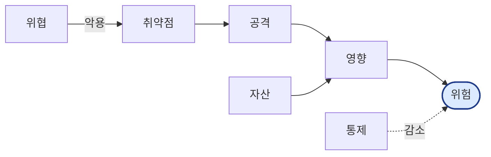
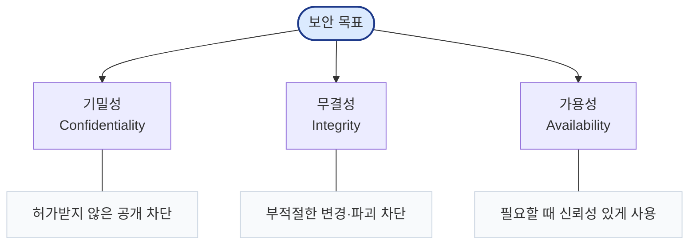
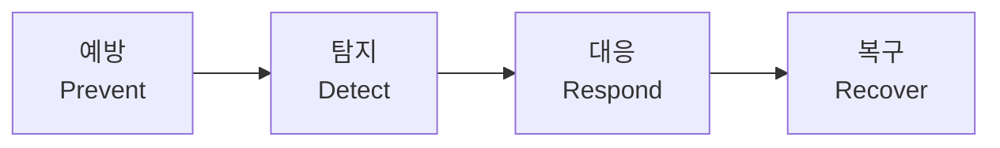
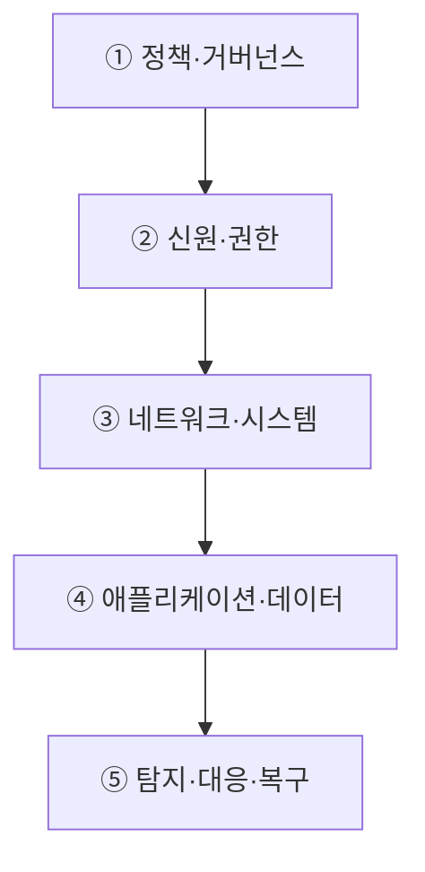
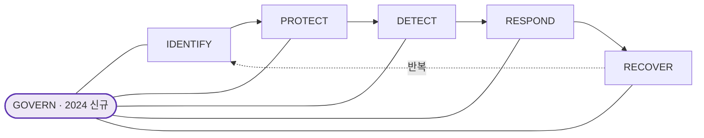

# 1주차 핵심 정리 — 보안 목표와 위험의 구조 (CIA)

> 시험 포인트: 용어들의 **정확한 구분**, CIA의 **의미와 실패 사례**, 통제의 **분류 체계**가 자주 섞여서 출제됨. "암호가 깨지지 않아도 보안이 실패할 수 있다"는 관점이 핵심.

---

## 1. 보안의 정의와 핵심 어휘

보안 = "가치 있는 자산이 **허용된 방식으로만** 사용되게 하는 것". 단순히 '공격을 막는 기술'보다 넓은 개념 (무엇을 지킬지, 누구에게 무엇을 허용할지, 실패를 얼마나 감수할지를 함께 결정).

### 📊 보안 용어의 연결 구조 (PPT: 자산→위협→취약점→위험→통제)

> 읽는 법: **위협**이 **취약점**을 악용해 **자산**을 **공격** → **영향** 발생. 이 전부가 **위험**(가능성 × 영향)으로 종합되고, **통제**가 위험을 줄인다.
> 읽는 법: **위협**이 **취약점**을 통해 **자산**을 공격 → **영향** 발생. 이 전부가 **위험**으로 종합되고, **통제**가 위험을 줄인다. (1주차 결론 문장과 동일)

### 7가지 핵심 용어 (순서와 구분이 중요)

| 용어 | 정의 | 핵심 질문 |
|------|------|-----------|
| **자산(Asset)** | 가치가 있어 보호해야 하는 것 | 무엇을 지키나? |
| **위협(Threat)** | 손실을 일으킬 수 있는 사건·주체 | 무엇이 손실을 일으키나? |
| **취약점(Vulnerability)** | 위협이 악용할 수 있는 약점 | 왜 공격이 성공하나? |
| **사건/공격(Attack)** | 위협이 실제로 작동한 상황 | 위협이 실제로 무엇을 했나? |
| **영향(Impact)** | 조직·개인·서비스에 생긴 결과 | 누가 무엇을 잃었나? |
| **통제(Control)** | 가능성·영향을 줄이는 조치 | 어떻게 줄이나? |
| **위험(Risk)** | 가능성과 영향의 결합 | 우선순위를 어떻게 정하나? |

> **흔한 함정**: 위협 ≠ 취약점 ≠ 공격. 이 셋을 섞으면 원인과 대책도 섞인다.
> - 위협 = 공격 가능성의 **주체/사건** (예: 불법 펨토셀 운영자, 악성코드)
> - 취약점 = 성공을 가능케 한 **약점** (예: 공유 인증서, 장기 유효기간, 검증 부재)
> - 공격 = 실제 **행위** (예: 망 접속, 암호화 해제, 정보 탈취)

### 자산의 두 종류
- **유형 자산**: 서버·네트워크·단말·시설, 백업·인증서·암호키, 예산·인력·운영 시간
- **무형 자산**: 데이터·서비스·소프트웨어, 업무 능력·신뢰·평판, 법적 지위·의사결정 가능성

### 위험(Risk)
- **위험 ≈ 가능성 × 영향** (정밀 공식이 아니라 사고를 구조화하고 우선순위를 정하는 출발점)
- 통제가 바꾸는 것: ① 공격 성공 가능성 ② 성공 시 영향 ③ 탐지·대응 시간 ④ 불확실성(증거의 질)
- **잔여 위험(residual risk)**: 통제 후에도 남는 위험. 누가 어떤 근거로 받아들일지가 **거버넌스**의 문제.
- **보안 거버넌스**: '누가 결정하고, 누가 책임지며, 무엇을 기준으로 감독할 것인가'를 정하는 체계.

---

## 2. CIA — 보안의 3대 목표

### 📊 CIA Triad (보안의 세 기둥)

CIA = 시스템이 유지해야 할 **최소 보안 요구** = "허용된 상태"의 정의.

> 📝 **필기 교정/보강**: 필기의 "CIA는 구현하기 위해 여러 가능이 나온다", "C·I·A 각각 무엇인지"는 맞는 방향. 정확히는 **CIA는 '목표(무엇을 지킬지)'이고, 통제·암호 알고리즘은 그 목표를 '구현하는 수단'**이라는 관계가 핵심.

### C — 기밀성 (Confidentiality)
- **정의**: 정보 접근·공개를 허가된 범위로 제한. "허가받지 않은 공개를 막는다."
- **핵심 통찰**: '읽지 못하게 한다'보다 **'누구에게 무엇을 허용할지'를 정의하는 것**이 먼저. 공개 범위를 정하는 일.
- **실패 모습**: 도청·유출·과도한 권한, 잘못된 공유·로그 노출, **메타데이터로 민감정보 추론**
- **대표 통제**: 인증·인가·최소권한 / 암호화·키 관리 / 분류·최소수집·마스킹

> ⭐ **중요 함정**: **암호화되어 있어도 기밀성은 실패할 수 있다.** (DB가 강하게 암호화돼 있어도, 정상 관리자 계정이 승인 없이 외부로 반출하면 → 암호 알고리즘은 안 깨졌지만 공개 범위가 정책을 벗어남 = 접근통제·감사·업무분리의 실패)
> - 기밀성 통제의 4가지 질문: 누구인지 확인(MFA·인증) / 무엇을 허용(RBAC·ABAC·최소권한) / 데이터 보호(암호화·마스킹·DLP) / 행위 추적(감사 로그·이상행위 탐지)

### I — 무결성 (Integrity)
- **정의**: 정보의 부적절한 변경·파괴를 막고 신뢰할 수 있게 함.
- **실패 모습**: 값 변경·삭제·삽입, 위조된 출처·재전송, 일부만 보이는 불완전한 기록
- **대표 통제**: 해시·MAC / 전자서명·인가·트랜잭션 / 감사로그·검증·승인

> ⭐ **무결성의 4가지 측면** (값만 같은지 보면 절반을 놓침):
> | 측면 | 질문 |
> |------|------|
> | 정확성 | 값이 의도한 현실·계산과 일치하는가? |
> | 완전성 | 필요한 항목·기록이 빠지지 않았는가? |
> | 진정성 | 주장한 사람·시스템에서 생성됐는가? |
> | 최신성 | 오래된 정상 값을 재사용한 건 아닌가? (재전송 공격) |

- 무결성 통제는 **예방 + 검증**을 함께:
  - 변조 방지: (예방) 인가·업무분리·입력검증 / (검증) 해시·MAC·서명
  - 원자적 처리: (예방) 트랜잭션 / (검증) 제약조건·reconciliation
  - 출처 확인: (예방) 강한 인증·키 보호 / (검증) 서명·인증서·provenance
  - 사후 추적: (예방) 변경 승인·버전관리 / (검증) append-only 로그·감사

### A — 가용성 (Availability)
- **정의**: 필요한 사용자가 필요한 때에 **신뢰성 있게** 접근·사용할 수 있게 함.
- **실패 모습**: DDoS, DNS 등 **의존성 실패**, 복구 지연·데이터 손상
- **대표 통제**: 이중화·용량·세그멘테이션 / DR·백업·복원 / 모니터링·자동복구·훈련

> ⭐ **의존성 함정**: **내 서버가 살아 있어도 서비스는 죽을 수 있다.** 가용성은 한 장비가 아니라 end-to-end 서비스 의존성(DNS→인증→DB→네트워크→Cloud API)을 따라가야 함. 관측 못 하는 의존성은 복구 우선순위에서도 빠진다.
> - 가용성은 **검증된 복구 과정**에서 드러난다 (단순히 백업만 있는 게 아니라, 정기 전환시험·부하시험·복원시험으로 검증).
> - RPO (Recovery Point Objective): 데이터 손상 시 어느 시점까지 복구 가능한가 (복구 목표 시점).

### CIA 우선순위는 상황에 따라 조정 (Trade-off)
| 상황 | 우선 목표 | 이유 |
|------|-----------|------|
| 응급 의료 | **A > I > C** | 생명 위해 긴급 접근 허용, 대신 사후감사 |
| 전자투표 | I·C | 비밀투표(C)와 결과 검증(I) 동시 |
| 공개 소프트웨어 | I·A | 코드는 공개돼도 배포물 출처는 검증 |
| 백업 시스템 | A·I·C | 복구 가능성·오염 여부·접근 제한 동시 확인 |

> **핵심**: 모든 목표를 최대로 만들 수 없으므로 **근거 있는 우선순위**가 필요.

### CIA를 넘어서는 추가 속성 (CIA만으로 설명 부족할 때)
| 속성 | 영문 | 질문 |
|------|------|------|
| 진정성 | Authenticity | 주장한 주체·출처가 맞는가? |
| 책임추적성 | Accountability | 누가 무엇을 했는지 추적 가능한가? |
| 부인방지 | Non-repudiation | 나중에 행위·전송을 부인하기 어려운가? |
| 프라이버시 | Privacy | 개인정보 처리의 목적·범위·권리를 지키는가? |
| 안전·복원력 | Safety & Resilience | 실패 시 피해를 제한·회복할 수 있는가? |

---

## 3. 통제(Control)와 방어 설계

### 통제의 3가지 유형 (무엇을 바꾸는가)
| 유형 | 바꾸는 것 | 예 |
|------|-----------|-----|
| **관리적** | 사람·책임·절차·의사결정 | 정책·교육·승인·협력사 관리·감사 |
| **물리적** | 공간·시설·장비 접근 | 출입통제·CCTV·전원 보호 |
| **기술적** | 시스템의 허용·차단·기록 방식 | MFA·암호화·방화벽·EDR·백업 |

> **핵심**: 세 유형이 서로의 실패를 보완. 한 종류만 강하면 **단일 실패점(SPOF)**이 남는다.

### 통제의 4가지 기능 (예방만으로 부족)

> 예방(접근통제·패치) → 탐지(로그·IDS·EDR) → 대응(격리·통보·포렌식) → 복구(백업·재구축). 예방만으로는 부족하고 네 기능이 이어져야 한다.

### 심층방어 (Defense in Depth)
- 서로 다른 실패 가정을 **겹치는** 것. 각 층은 같은 실패를 반복하지 않고 **다른 가정·관측·복구 경로**를 제공.

> 한 층이 뚫려도 다음 층이 **다른 가정**으로 막는다. 양파처럼 겹친 방어.

### 설계 원칙 (기술이 바뀌어도 살아남는 질문)
| 원칙 | 의미 |
|------|------|
| **최소권한** | 꼭 필요한 자원·시간·권한만 허용 |
| **안전한 기본값** | 명시적 허용이 없으면 거부(default deny) |
| **완전한 중재** | 모든 접근을 매번 검증 |
| **개방형 설계** | 비밀 설계(security by obscurity)가 아니라 **키·자격증명**을 보호 |

> 📝 필기 보강: CISO = Chief Information Security Officer (최고정보보호책임자).

### NIST CSF 2.0 — 보안 수명주기 (6기능, 동시 반복)

> ⭐ GOVERN(책임·정책·위험)이 **중심**에서 나머지 5기능을 감독. CSF 2.0은 2024년 GOVERN을 추가해 보안을 **경영·책임의 문제**로 분명히 함. 기능들은 순차가 아니라 **동시 반복**되는 수명주기.

> 📝 필기 보강: SBOM = Software Bill of Materials (소프트웨어 구성요소 명세서).

---

## 4. 실제 사고로 보는 CIA (KT 2025 사례)

- 숫자(규모)는 사고의 크기를 보여주지만 **원인을 설명하지는 않음**.
- 같은 사건도 **보는 대상에 따라** C·I·A가 달라진다:
  - **C**: 가입자 식별정보·인증정보가 허가 없이 노출?
  - **I**: 결제 요청·인증·자산 기록을 신뢰할 수 있나?
  - **A**: 정상 사용자가 서비스를 제때 쓸 수 있었나?
- 교훈: 사고를 분석할 때 사고 이름보다 **자산→위협→취약점→위험→통제**의 관계를 먼저 구분하고, 반드시 **사실(증거)로 근거**를 붙인다.

---

## ✅ 1주차 핵심 3문장
1. **보안 목표**: CIA는 시스템이 유지해야 할 허용 상태를 정의한다.
2. **위험 언어**: 위협은 취약점을 통해 자산에 영향을 주고, 통제는 이를 줄인다.
3. **설계 판단**: 모든 목표를 최대로 만들 수 없으므로 근거 있는 우선순위가 필요하다.
