# 2주차 핵심 정리 — 대칭키 암호와 엔트로피

# 2주차 핵심 정리 — 대칭키 암호

> 전체 서사: **원리 → 실패 → 개선 → 구현**. 각 암호/모드가 "이전 방식의 어떤 구체적 실패를 줄이려고" 나왔는지가 핵심.

### 📊 대칭키 암호 발전 흐름 (왜 다음 것이 필요했나)
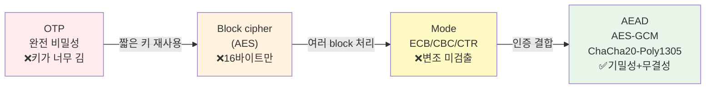

---

## 1. OTP와 대칭키 모델

### One-Time Pad (OTP)
- **원리**: 평문 비트 M과 **완전히 무작위**인 키 비트 K를 XOR. `C = M ⊕ K`. 같은 K를 다시 XOR하면 복원 (`M ⊕ K ⊕ K = M`, `K ⊕ K = 0`).
- **장점**: **완전 비밀성(perfect secrecy)** — 이론적으로 절대 깰 수 없음.
- **단점(C·I·A 관점의 한계)**:
  - 키가 **메시지와 같은 길이**여야 하고 **한 번만** 써야 함 → 긴 파일마다 새 키 필요
  - 송·수신자가 그 긴 키를 **안전하게 미리 공유**해야 함 (📝 필기: "키 공유 어려움, 키 길어짐")
- **결론**: 완전하지만 비실용적 → **짧은 키를 반복 사용하지 않는** 대칭키 암호(AES 등)가 필요.

### XOR의 복호 성질 (OTP·스트림 암호의 핵심)

> `0⊕1=1`, `1⊕1=0`. 같은 키를 두 번 적용하면 서로 지워짐: **M ⊕ K ⊕ K = M** (K⊕K=0).

### 대칭키 모델
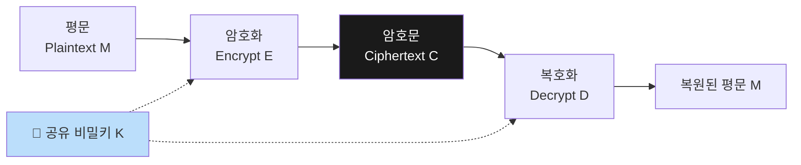
- `C = Eₖ(M)`, `M = Dₖ(C)` — 같은 키 K를 암·복호 양쪽에 사용.
- 첫 번째 설계 질문: **"안전한 K는 어디서 오는가?"** → 뒤의 엔트로피/CSPRNG 주제로 연결.

### 대칭키 알고리즘의 두 종류
| 구분 | Block cipher | Stream cipher |
|------|--------------|---------------|
| 동작 | 고정 크기 **block 변환** | **keystream 생성 → 평문과 XOR** |
| 대표 | DES, 3DES, **AES**, Blowfish, Twofish | RC4, Salsa20, **ChaCha20** |
| 추가 설계 | 여러 block 처리할 **mode** 필요, 짧은 입력엔 **PKCS#7 padding** | partial block도 필요한 만큼만 처리(padding 불필요), **같은 key·nonce 재사용 금지** |
| 현대 조합 | AES-GCM | ChaCha20-Poly1305 |

> ⭐ **중요 관계**: **CTR(Counter mode)은 block cipher인 AES를 스트리밍처럼 쓰는 '모드'**이고, **ChaCha20은 본래 stream cipher 알고리즘**이다. (둘을 혼동하는 함정 자주 출제)

### 대칭키 보안의 3가지 요구사항
1. **기밀성**: 평문→암호문. 단, **암호화만으로는 변조·출처를 확인 못 함.**
2. **무결성·인증**: MAC 또는 AEAD가 암호문·헤더 변경을 탐지.
3. **키 관리**: 생성·저장·사용·회전·폐기. 알고리즘이 강해도 **키를 예측·분실하면 시스템 실패.**

---

## 2. 암호 입력 값들 — Key / Nonce / IV / Salt (매우 중요)

| 값 | 비밀? | 핵심 조건 | 역할 |
|----|-------|-----------|------|
| **Key** | 🔒 비밀 | 예측 불가능·용도 분리·접근통제 | 암호 연산의 비밀 입력 |
| **Nonce** | 공개 가능 | **같은 key에서 규격대로 유일(unique)** | 한 번의 연산(인스턴스) 구분 |
| **IV** (Initialization Vector) | 공개 가능 | mode별 **무작위 또는 유일** | 첫 block 상태를 다양화 |
| **Salt** | 공개 | 사용자·레코드별 유일 | 비밀번호 KDF의 **사전계산 공격 분리** |

> 📝 **필기 핵심(정확함)**: "같은 알고리즘으로 암호화된 메시지를 여러 개 보면 유출 가능 → **Nonce와 IV를 추가하여 매번 다르게** 보냄." → 같은 키라도 nonce/IV를 바꾸면 같은 평문도 다른 암호문이 됨.
> 📝 필기 "Nonce = 한 번만 쓰는 숫자(number used once)"도 맞음.

### Kerckhoffs의 원칙 ⭐
- **"숨겨야 하는 것은 알고리즘이 아니라 키다."** 시스템(알고리즘)이 공개돼도 **키 없이는 안전**해야 함.
- 소스코드 비공개는 추가 장벽은 될 수 있지만 **암호학적 근거는 될 수 없다** (= security by obscurity 금지).
- 📝 필기(정확): "알고리즘이 공개돼도 Key만 모르면 안전하다."

### 공격 모델 (공격자가 가진 능력 순으로)
| 모델 | 영문 | 공격자가 할 수 있는 것 |
|------|------|------------------------|
| 암호문만 | Ciphertext-only | 암호문 집합만 관측 |
| 알려진 평문 | Known-plaintext | 일부 평문-암호문 쌍을 앎 (예: 파일 헤더) |
| 선택 평문 | Chosen-plaintext | 원하는 입력을 암호화하는 API 호출 가능 |
| 선택 암호문 | Chosen-ciphertext | 변형 암호문의 복호 결과·오류 관측 → **oracle 공격**으로 이어짐 |

### 보안 강도와 키 길이
- `W(k) ≈ 2^k` : k-bit 키의 전수조사(brute force) 작업량 ≈ 2^k. AES-128 → 약 128비트 강도.
- **가장 약한 요소**(알고리즘 구조·키 길이·공격 모델·구현)가 전체 보안을 제한. 구현 누수(사이드채널)는 별도 문제.

---

## 3. 블록 암호와 AES

### DES → AES로 바뀐 이유 (C·I·A·성능 관점)
| 단계 | 알고리즘 | 왜 바뀌었나 |
|------|----------|-------------|
| OLD | **DES** | 56-bit key가 brute force에 취약, 64-bit block도 대용량 처리 제약 |
| BRIDGE | **3DES/TDEA** | DES를 3번 적용한 전환기 호환책. 느리고 신규엔 비권장 |
| CURRENT | **AES** | 128-bit block, 128/192/256-bit key. 현재 표준 |

### AES 기본 사양
- **Block**: 128 bits = 16 bytes를 **4×4 state 배열**로 배치
- **Key**: 128/192/256 bits → 각각 **10/12/14 rounds** (Nr)
- **표준 문서**: FIPS 197

### AES 라운드 구조 ⭐ (전체 흐름)
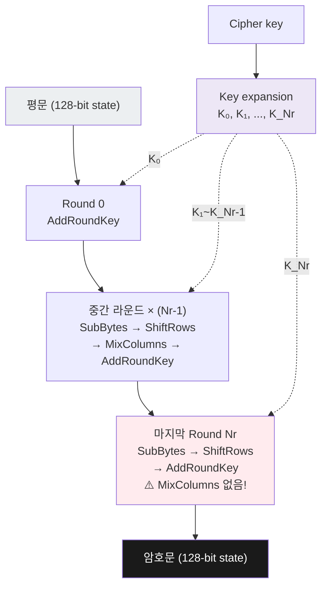
> ⭐ **마지막 라운드엔 MixColumns가 없다** (시험 단골). Round 0은 AddRoundKey만 먼저 수행.
- 각 라운드 키는 원래 키에서 **key schedule(key expansion)**로 생성. 키는 공개돼도 되지만 **입력 키는 비밀**이어야 함.
- ⭐ **마지막 라운드엔 MixColumns가 빠진다** (복호화의 대칭성/구조상 이유. 시험 단골).

### AES 라운드의 4단계와 "혼돈·확산" ⭐⭐
| 단계 | 동작 | 목적 |
|------|------|------|
| **SubBytes** | 각 byte를 **비선형 S-box**로 치환 | **혼돈(Confusion)** — 키·암호문 관계를 단순식으로 추적 어렵게 |
| **ShiftRows** | state의 행을 서로 다른 거리로 순환 이동 | **확산(Diffusion)** — 한 열의 byte를 여러 열로 흩음 |
| **MixColumns** | 각 열을 **유한체(GF)** 위에서 선형 결합 | **확산** — 한 byte 변화를 같은 열 여러 byte로 퍼뜨림 |
| **AddRoundKey** | state와 round key를 **XOR** | 비밀키에 따라 실제 변환이 달라짐 |

- **혼돈(Confusion)**: SubBytes의 비선형 치환 + round key 결합 → 키·암호문 관계를 복잡하게. (주로 SubBytes)
- **확산(Diffusion)**: ShiftRows + MixColumns → 한 비트 영향을 state 전체로. 여러 라운드 뒤 **1비트 변화가 많은 암호문 비트를 바꿈**.

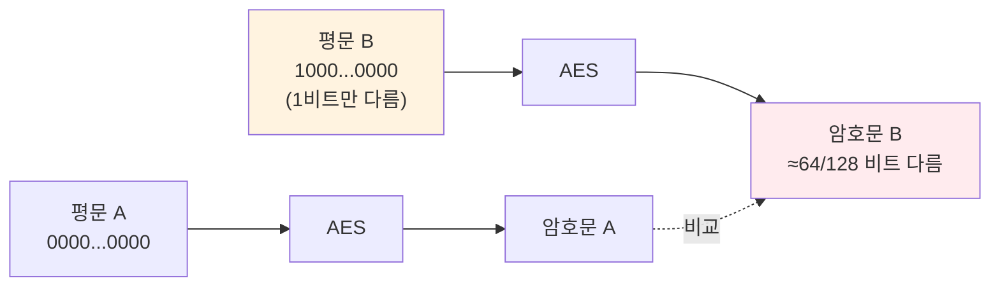
> **눈사태 효과(Avalanche)**: 입력 1비트 차이 → 출력 절반(≈64비트)이 바뀜. 학습 목표는 손계산이 아니라 **각 단계가 왜 필요한지** 설명하는 것.

### 💻 실습 코드 ① AES Avalanche(눈사태 효과)
```python
from cryptography.hazmat.primitives.ciphers import Cipher, algorithms, modes
from secrets import token_bytes
key = token_bytes(16)
p1 = bytes(16)                     # 16바이트 전부 0
p2 = bytes([1]) + bytes(15)        # 딱 1비트만 다른 평문
def raw_aes(block):
    enc = Cipher(algorithms.AES(key), modes.ECB()).encryptor()
    return enc.update(block) + enc.finalize()
c1, c2 = raw_aes(p1), raw_aes(p2)
changed = sum((a ^ b).bit_count() for a, b in zip(c1, c2))  # 달라진 비트 수
print(changed, "/ 128 ciphertext bits changed")
```
**이해 포인트** (시험 가능):
- 목적: 평문 **1비트** 변화가 암호문 전체로 확산(avalanche)되는지 확인.
- **예상 결과: 128비트 중 약 64비트(절반)가 변함** → 좋은 확산의 증거.
- `bytes(16)` = 0으로 채운 16바이트, `p2`는 첫 바이트만 `0x01`로 1비트 차이.
- `(a^b).bit_count()` = XOR 후 1인 비트 수 세기(= 달라진 비트).
- ⚠️ **ECB는 한 블록만 관찰하기 위한 실험 도구일 뿐, 실제 파일 암호화에 쓰면 안 됨.**

---

## 4. 패딩과 운용 모드

### 패딩·모드가 필요한 이유
- AES는 한 번에 **16바이트만** 암호화 → 길이가 다른 데이터·여러 block을 어떻게?
- **padding**: block 길이를 맞춤 / **mode**: 여러 block의 처리 관계와 보안 성질을 정함.

### PKCS#7 패딩 ⭐
- 부족한 바이트 수 **p**를 **p번** 붙인다. 패딩 길이는 항상 **1~16 bytes**.
- 예: 'HELLO'(5바이트) → 11바이트 부족 → `0B`(=11)을 11번 추가.
- ⭐ **이미 16바이트 배수여도** `10`(=16)을 **16번** 붙인다 (완전한 padding block). → 데이터와 padding을 **항상 구분**(일관성)하기 위해.
  - 15바이트 → `01`
  - 14바이트 → `02 02`
  - 16바이트 → `10 × 16` (10은 0x10 = 16)
- 📝 필기(정확): "마지막이 16-byte로 떨어지더라도 padding으로 채우는 게 기준(일관성)."

### 모드 로드맵 ⭐⭐ (각 모드가 얻는 것 / 남는 문제)
| 모드 | 얻는 것 | 남는 문제 |
|------|---------|-----------|
| **ECB** | 각 block 독립 암호화(단순·병렬) | **반복 패턴 노출** |
| **CBC** | 이전 암호문과 연결 → 반복 패턴 숨김 | **변조 검출 없음**, padding oracle 가능 |
| **CTR** | 병렬성, padding 불필요(스트림처럼) | nonce 재사용 치명, **Malleability**(변조 가능), 인증 없음 |
| **AEAD** | 기밀성 + **인증 tag** | nonce·API 계약을 반드시 준수 |

---

### 모드 1: ECB (Electronic Codebook)
- 같은 key + 같은 평문 block → **항상 같은 암호문 block** (`P1=A → C1=X`, `P2=A → C2=X`).
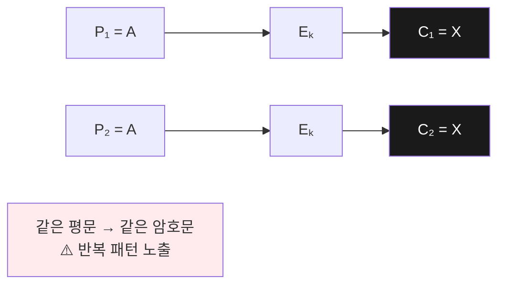
- **장점**: 단순·병렬 가능.
- ⭐ **치명적 단점**: 반복·위치 구조가 그대로 남음 (펭귄 이미지가 ECB로 암호화돼도 윤곽이 보이는 유명 사례).
- **펭귄 사례**: 내용(문자)을 못 읽어도 **반복 block이 만드는 윤곽**(동일 색 영역·경계·물체 윤곽)은 남음.
  - 📝 필기(정확): "한 색은 암호화해도 암호문이 모두 같다 → 반복 패턴 노출."
  - 교훈: **기밀성은 '문자를 못 읽음'보다 더 강한 요구** (구조·패턴도 숨겨야 함).

### 모드 2: CBC (Cipher Block Chaining)
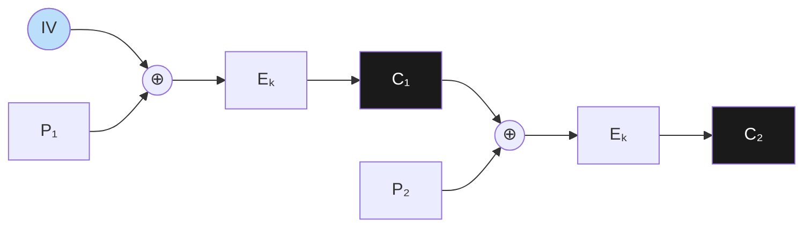
- **암호화**: 각 평문 block을 **이전 암호문과 XOR**한 뒤 AES 암호화.
  - `C₁ = Eₖ(P₁ ⊕ IV)`, `C₂ = Eₖ(P₂ ⊕ C₁)` (C₀ = IV)
- **복호화**: `P₁ = Dₖ(C₁) ⊕ IV`, `P₂ = Dₖ(C₂) ⊕ C₁` (D는 E의 역변환, 같은 키 K)
- 효과: 같은 평문 block도 앞의 C가 다르면 AES 입력이 달라짐 → **ECB의 반복 패턴을 숨김**.
- `⊕`는 XOR(배타적 논리합)이지 산술 덧셈(+)이 아님. (예: 1010 ⊕ 0110 = 1100)
- 📝 **필기 핵심(정확)**: "IV는 암호화해서 보낼 필요 없음. 공격자는 key 값을 모르기 때문에, **IV를 알아도 문제 없다**." (IV는 공개 가능)

#### CBC의 실패 1 — Malleability(연성, 암호문 변조 가능성) ⭐
- **정의**: 공격자가 **키를 몰라도** 암호문을 바꾸어 복호된 평문에 **예측 가능한 변화**를 일으킬 수 있는 성질. 즉 **기밀성은 있어도 무결성은 보장 안 됨**.
- **CBC bit-flipping**: `Pᵢ = Dₖ(Cᵢ) ⊕ Cᵢ₋₁`. 이전 암호문 블록의 어떤 비트를 뒤집으면 → 대응 평문 비트가 뒤집힘 (평문 위치가 0x00이면 0x01로).
- 대가: 이전 평문 block 일부는 손상되지만, **인증 태그가 없으면 변조를 탐지 못 할 수 있음**.

#### CBC의 실패 2 — Padding Oracle 공격 ⭐⭐⭐ (시험 핵심, 실습 포함)
**공격 조건**: CBC + PKCS#7 padding + **성공/실패를 구별할 수 있는 서버 반응**.

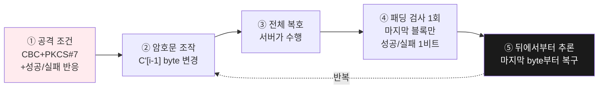

**동작 원리**:
1. 서버는 암호문 **전체를 복호**한 뒤 **마지막 블록의 padding이 올바른지만** 한 번 검사.
   - ⚠️ 서버가 각 byte에 답하는 게 아님. 매 질의마다 "padding 전체가 유효한가"에 대한 **성공/실패 1비트**만 알려줌.
2. 공격자는 `C[i]`는 고정, **이전 블록 `C'[i-1]`의 byte를 조작**해서 질의 반복.
3. **마지막 byte부터** 복구 (뒤에서부터).

**왜 마지막 byte부터?** `0x01`로 만들면 검사할 padding이 그 한 byte뿐 → 앞 15바이트는 무엇이든 상관없어 가장 단순.

**서버 반응 차이 예** (취약한 서버에서만 성립):
- 패딩 실패 → "Invalid padding", HTTP 500, 빠른 종료
- 패딩 성공 → "Invalid token", HTTP 403, 후속 처리 후 응답
- 공격자는 이 차이로 "복호 결과 끝이 유효한 padding이 됐다"는 1비트를 얻음.

**토이 예시 (마지막 byte 계산)** — 핵심 수식:
```
목표: P'ᵢ[15] = 0x01 이 되는 조작값 찾기
   P'ᵢ[15] = Iᵢ[15] ⊕ C'ᵢ₋₁[15]
원래 C[i-1][15] = 0x7A. C'[i-1][15]를 00~FF로 바꾸다 0x3C에서 padding 성공.
→ Iᵢ[15] ⊕ 0x3C = 0x01  ⟹  Iᵢ[15] = 0x3D   (중간값 복구)
→ Pᵢ[15] = Iᵢ[15] ⊕ Cᵢ₋₁[15] = 0x3D ⊕ 0x7A = 0x47 = 'G'  (원래 평문 복구!)
```
- 최대 256번(평균 128번) 질의로 **한 byte** 복구.
- ⭐ **알아내는 것은 AES 키가 아니라, 중간값 I[i]와 원래 평문 byte**다.
- 한 블록 전체: `01 → 02 02 → 03 03 03 → … → 10×16` 순서. 두 번째 byte 탐색 시엔 앞 byte를 `02 02`가 되도록 C'를 재설정하고 반복.
- 📝 필기(정확): "for loop"로 00~FF 전수 탐색.

**결과·역사·방어**:
- 한 block 복구에 최대 ≈ **16×256 = 4096번**, 평균 ≈ **2048번** 질의.
- 2002년 **Serge Vaudenay**가 체계화. 세션 쿠키·인증 토큰·개인정보 평문 복구에 악용. **AES 키 자체는 못 얻음.**
- 관련 사례(동일 공격은 아니지만 CBC padding/오류·시간 부채널 악용): **POODLE(2014)**, **Lucky Thirteen(2013)**.
- **방어**: ① AEAD 사용(AES-GCM, ChaCha20-Poly1305) ② legacy CBC는 padding/MAC 오류·시간을 구별 못 하게 처리 ③ 복호 결과를 외부에 내보내기 전 **인증 먼저 검증** ④ 반복 질의 제한·관찰·차단.

### 모드 3: CTR (Counter Mode) ⭐
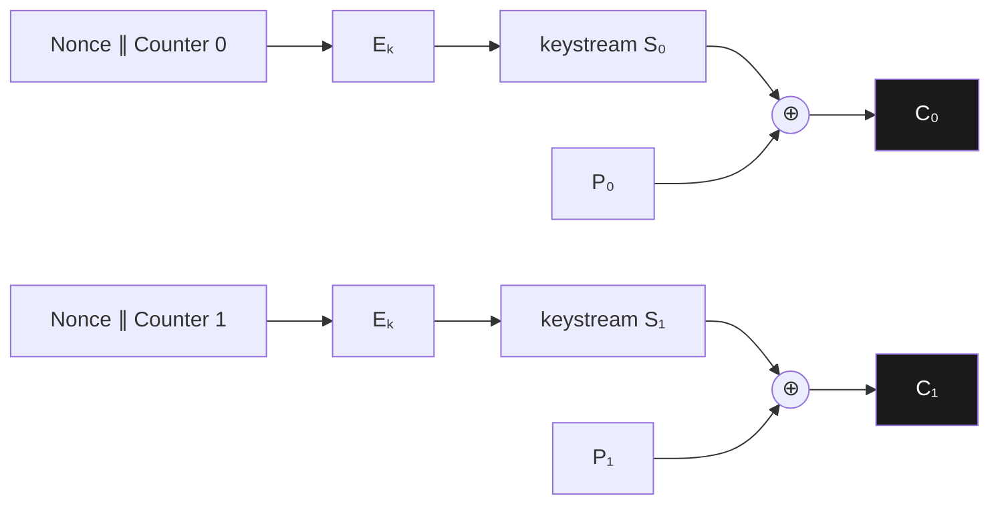
> ⭐ AES는 **데이터(평문)를 직접 받지 않고** counter를 암호화해 keystream('가짜 난수열')을 만든 뒤 평문과 XOR. 그래서 block cipher지만 **스트림처럼** 동작하고 **padding 불필요**.

- **동작**: AES에 **nonce∥counter**(붙여서 128비트 입력)를 넣어 **keystream block Sᵢ**를 만들고, 평문과 XOR.
  - `Sᵢ = Eₖ(N ∥ ctrᵢ)`, `Cᵢ = Pᵢ ⊕ Sᵢ`, `Pᵢ = Cᵢ ⊕ Sᵢ`
- ⭐ **CTR은 별도의 스트림 암호 '알고리즘'이 아니라 block cipher '모드'** (📝 필기: "block cipher지만 stream cipher처럼 쓴다").
- **장점**: 병렬 처리, 길이 보존, 실시간 처리, **padding 불필요**(마지막 짧은 조각은 필요한 만큼만 잘라 씀).
- **단점**: 인증은 별도(변조 검출 못 함). **같은 key·nonce 재사용 시 치명적.**

#### CTR 1-byte 토이 예시
```
P₀ = 'A' = 0x41,  S₀ = Eₖ(N∥0) = 0x9F,  C₀ = P₀ ⊕ S₀ = 0xDE
복호: P₀ = C₀ ⊕ S₀ = 0xDE ⊕ 0x9F = 0x41 = 'A'
```
(실제 S₀는 128비트 블록. 위는 원리만 보이는 toy)

#### CTR 실패 — Nonce 재사용 ⭐⭐
- 같은 key·nonce → **같은 keystream S 반복**.
  - `C₁ ⊕ C₂ = (P₁ ⊕ S) ⊕ (P₂ ⊕ S) = P₁ ⊕ P₂`  (keystream S가 소거됨!)
  - 한 평문의 일부를 알거나 구조를 추측하면 다른 평문 복구: `P₂ = C₁ ⊕ C₂ ⊕ P₁`
- 📝 필기(정확): "nonce 재사용하면 안 된다. 위와 같은 공격이 가능해지므로."
- **nonce를 숨겨도 해결 안 됨**(공개 가능 값, 문제는 '유일성'). CTR은 인증도 제공 안 함.

#### 💻 실습 코드 ② CTR Nonce 재사용
```python
def xor(a, b):
    return bytes(x ^ y for x, y in zip(a, b))
# 동일 key·nonce에서 나온 두 ciphertext라고 가정
p1 = b"pay=1000;to=alice"
p2 = b"pay=9000;to=carol"
keystream = bytes.fromhex("9f" * max(len(p1), len(p2)))
c1 = xor(p1, keystream)
c2 = xor(p2, keystream)
recovered_p2 = xor(xor(c1, c2), p1)   # P2 = C1 ⊕ C2 ⊕ P1
print(recovered_p2)  # b"pay=9000;to=carol"
```
**이해 포인트**: P1을 알면 `C1⊕C2⊕P1 = P2`로 **P2를 완전 복구**. 공격 수식만 격리한 toy지만 실제 CTR에서도 동일 key·nonce는 동일 keystream을 만든다는 점이 핵심.

---

## 5. 인증의 등장 — Encrypt-then-MAC → AEAD

**흐름**: ECB(반복 패턴) → CBC/CTR(기밀성은 개선) → **남은 문제: 변조 미검출** → Encrypt-then-MAC(암호문에 인증 tag) → **AEAD(검증된 단일 API로 통합)**.
> 고급 기법은 '더 복잡해서'가 아니라 **이전 기법의 구체적 실패를 줄이려고** 등장한다.

### Encrypt-then-MAC 구성 ⭐
- `C = Enc(K_enc, M)`, `T = MAC(K_mac, header ∥ IV/nonce ∥ C)`
- ⭐ **Tag T는 암호문 C를 '암호화'한 값이 아님.** 별도 인증 키로 header·IV/nonce·C **전체에서 계산한 검증값**.
- 📝 필기(정확):
  - **키가 2개 필요**: `K_enc`(암호화), `K_mac`(인증) — 용도 분리.
  - Alice가 (C, T)를 Bob에게 전송 → Bob은 K로 복호 + T를 다시 계산해 Alice가 보낸 T와 **일치하는지 확인**.
- MAC = Message Authentication Code (공유 비밀키로 변조·출처 확인).

### 주요 약어 (개념으로)
| 약어 | 전체 이름 | 역할 |
|------|-----------|------|
| AES | Advanced Encryption Standard | 128-bit block을 비밀키로 변환 |
| CSPRNG | Cryptographically Secure PRNG | 키·nonce 생성에 필요한 예측 저항 |
| IV | Initialization Vector | mode의 첫 상태를 다르게 |
| MAC | Message Authentication Code | 변조·출처 확인 |
| AEAD | Authenticated Encryption with Associated Data | 기밀성 + 인증을 한 API에서 |

> 📝 필기(정확): CSPRNG는 "**암호와 안전한 난수 사용**"에 필요. "NAND로(약한 방식으로) 생성한 걸 사용하면 위험" — 즉 보통 난수(PRNG)로 키·nonce를 만들면 안 됨.

### 보안 목표 ↔ 도구 ↔ 흔한 오해
| 목표 | 도구 | 빠지기 쉬운 오해 |
|------|------|------------------|
| 기밀성 | 대칭키·공개키 암호 | "암호화만으로 변조도 검출된다" ❌ |
| 무결성·인증 | MAC·AEAD·전자서명 | "일반 해시만으로 공격자를 막는다" ❌ |
| 키 생성·분리 | CSPRNG·KDF | "일반 해시를 적용하면 비밀키가 된다" ❌ |
| 가용성 | 백업·복구·키 수명주기 | "강한 암호가 키 분실도 해결한다" ❌ |

---

## 6. AEAD와 GCM ⭐⭐⭐ (시험 핵심)

### AEAD 개념
- **AEAD = Authenticated Encryption with Associated Data**: 기밀성 + 무결성/인증을 **하나의 API**에서 제공.
- GCM은 암호문·tag를 만들고, **AAD의 변조도 함께 검출**.
- 📝 필기(정확): AAD = "Alice와 Bob이 **서로 알고 있는(숨길 필요 없는) 데이터**", AEAD는 "기밀성을 위해" (정확히는 기밀성 + 인증).

### AEAD 입출력
| 항목 | 공개/비밀 | 규칙 |
|------|-----------|------|
| Key | 🔒 비밀 | 충분한 entropy·용도 분리·안전한 저장 |
| Nonce | 공개 가능 | 같은 key에서 **규격대로 유일** |
| Plaintext | 비밀 대상 | 암호문으로 변환 |
| **AAD** | 공개 | version·header처럼 **숨기진 않지만 변조는 막을** 데이터 |
| Ciphertext + Tag | 공개 | **tag 검증 실패 시 평문 반환 안 함** |

- **AAD(Additional Authenticated Data)**: 파일 header·protocol version·record ID처럼 숨길 필요는 없지만 변조되면 안 되는 정보. **암호화하진 않되 tag 계산에 포함**.
- **Tag T**: 공개 가능. `T = Tagₖ(N, A, C)`. 수신자가 같은 비밀 K로 다시 계산해 **일치할 때만** 평문 사용. 키 K는 tag에 포함·전송되지 않음.
- 공개 가능: nonce · AAD · ciphertext · tag / 비밀: **key · plaintext**

### AES-GCM 내부 구조 ⭐⭐ (세 구성요소)
| 구성요소 | 역할 | 수식 |
|----------|------|------|
| **AES-CTR** | 기밀성(암호화) | `Cᵢ = Pᵢ ⊕ Eₖ(inc(J₀))` |
| **GHASH** | 무결성 계산 핵심 | `S = GHASH_H(A, C)` |
| **AES tag mask** | tag 완성 | `T = MSBₜ(Eₖ(J₀) ⊕ S)` |

### 📊 AES-GCM 전체 데이터 흐름 (비밀키 K 하나로 세 용도)
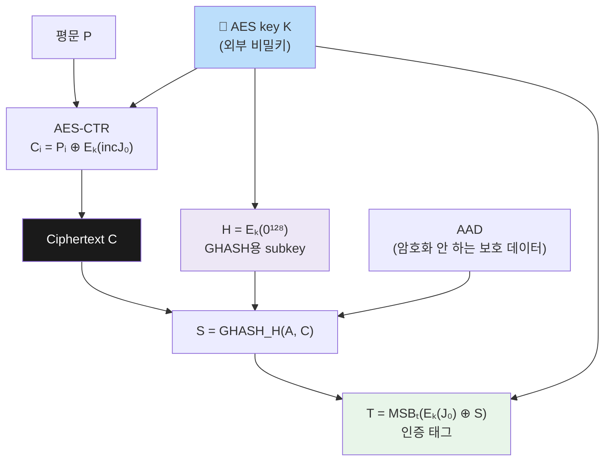
> 공개·전송: N·A·C·T / 비밀: K·P. **GHASH는 plaintext가 아니라 ciphertext C를 인증**.

- ⭐ **외부에서 관리하는 비밀키는 K 하나.** 내부에서 같은 K를 서로 다른 입력에 적용해 용도별 값(암호화·H·마스크)을 만듦.
- **H (GHASH subkey)**: `H = Eₖ(0^128)` — K로 **0으로만 된 128비트 블록을 암호화**한 값 (📝 필기: "0으로 128비트 채운 값"). GHASH 전용 내부 서브키.
- **GHASH 누적 계산**: `Y₀ = 0^128`, `Yᵢ = (Yᵢ₋₁ ⊕ Xᵢ)·H`, `S = Yₘ`. 곱셈은 **GF(2^128)** 유한체에서.
- GHASH 입력 형식: `X = A ∥ 0ᵛ ∥ C ∥ 0ᵘ ∥ |A|₆₄ ∥ |C|₆₄` — 마지막에 **두 길이를 넣어 경계를 고정** → "AAD=AB,C=C"와 "AAD=A,C=BC"를 다른 입력으로 처리.
- ⭐ **GHASH는 plaintext가 아니라 ciphertext C를 인증**한다.

#### 왜 AES 마스크가 필요한가 (중요)
- **GHASH는 선형(universal hash)**이라 출력 S를 그대로 공개하면 **안전한 독립 MAC이 되지 못함**.
- 그래서 `T = MSBₜ(Eₖ(J₀) ⊕ S)` — J₀(nonce에서 만든 초기 counter block)로 만든 **AES 출력 `Eₖ(J₀)`을 nonce별 비밀 마스크**로 씌워 tag를 완성.

### AES-GCM 송신/수신 흐름
**송신**: 입력 준비(K·unique nonce·P·AAD) → AES-CTR로 C → GHASH로 S → tag 완성 T → **(nonce·AAD·C·T) 함께 전송**.
> AES-GCM 출력은 ciphertext 하나가 아니라 **nonce·AAD·ciphertext·tag로 구성된 인증 레코드**.

**수신(검증)** ⭐:
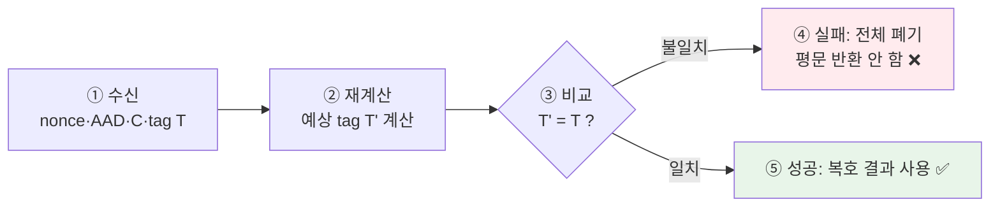
> ⭐ **"일단 복호화하고 나중에 검사"하지 않는다.** 인증 안 된 부분 평문은 절대 사용 안 함.
> 인증 실패를 padding 오류·업무 오류와 구분해 외부 노출 안 하는 것도 중요(부채널 방지).

#### GCM 실패 — Nonce 재사용 ⭐⭐ (CTR보다 더 치명적)
같은 key·nonce를 재사용하면 **두 가지**가 동시에 깨짐:
1. **CTR keystream 반복**: `C⁽¹⁾ ⊕ C⁽²⁾ = P⁽¹⁾ ⊕ P⁽²⁾` (평문 관계 노출)
2. **tag mask 반복**: `T⁽¹⁾ ⊕ T⁽²⁾ = S⁽¹⁾ ⊕ S⁽²⁾` (GHASH 관계 노출 → **인증 위조 가능**)
- 📝 필기(정확): "재사용하면 안 된다." → **동일 key에서 nonce N을 절대 재사용 금지.**

### ChaCha20-Poly1305 (AES-GCM의 중요한 대안)
| 구성 | 역할 |
|------|------|
| **ChaCha20** | 256-bit key·96-bit nonce로 keystream 생성 → 평문과 XOR (암호화) |
| **Poly1305** | AAD·ciphertext 인증 (MAC) |
- **왜?**: AES 전용 하드웨어 명령어가 **약한 장치에서도 빠르고**, constant-time 구현이 비교적 쉬움(사이드채널 저항).
- 같은 key·nonce 재사용 금지(동일).

### AES-GCM 요약
- **CONFIDENTIALITY** = AES-CTR (혼자서는 변조 탐지 못 함)
- **INTEGRITY CORE** = GHASH (빠른 universal hash, 단독 MAC 아님)
- **COMPLETE AEAD** = AES-GCM. TLS 1.3·QUIC의 사실상 표준 AEAD. **동일 key에서 nonce 절대 재사용 금지**.

### TLS 1.3의 AEAD 레코드 (적용 예)
- **보이는 것**: IP 주소·record length·일부 outer header. TLS 1.3은 record header를 **AAD로 인증**, sequence number로 nonce 생성.
- **숨겨지고 검증되는 것**: HTTP 요청·응답은 ciphertext+tag로 보호. AAD·ciphertext·tag가 조금만 달라도 **InvalidTag로 거부**.

### 💻 실습 코드 ③ AES-GCM 변조 테스트
```python
from cryptography.hazmat.primitives.ciphers.aead import AESGCM
from secrets import token_bytes
key, nonce = token_bytes(32), token_bytes(12)
aad = b"vault:v1"
pt = b"final-grade=95"
ct = AESGCM(key).encrypt(nonce, pt, aad)   # 암호문+tag
bad = bytearray(ct); bad[0] ^= 1           # 1비트 변조
try:
    AESGCM(key).decrypt(nonce, bytes(bad), aad)
except Exception as e:
    print(type(e).__name__)                # InvalidTag
```
**이해 포인트**: 암호문 1비트만 바꿔도 복호가 평문 대신 **InvalidTag 예외**를 던짐. AAD 1비트 변경도 동일. 키=32바이트(256비트), nonce=12바이트(96비트). ⚠️ nonce·key 재사용 실험은 실제 데이터로 하지 않음.

### 💻 실습 코드 ④ AES-GCM 파일 암호화 (기본 형태)
```python
from pathlib import Path
from secrets import token_bytes
from cryptography.hazmat.primitives.ciphers.aead import AESGCM
def encrypt(src, dst, key):
    nonce = token_bytes(12)                               # 96비트 nonce
    data = Path(src).read_bytes()
    c_and_tag = AESGCM(key).encrypt(nonce, data, None)    # 암호문+인증태그
    Path(dst).write_bytes(nonce + c_and_tag)              # nonce도 함께 저장
def decrypt(src, dst, key):
    blob = Path(src).read_bytes()
    nonce, c_and_tag = blob[:12], blob[12:]               # nonce와 나머지 분리
    data = AESGCM(key).decrypt(nonce, c_and_tag, None)    # 인증+복호
    Path(dst).write_bytes(data)
```
**이해 포인트**: 저장 형식 = **12-byte nonce ∥ ciphertext ∥ 16-byte tag**. nonce는 비밀이 아니므로 파일에 같이 저장. ⚠️ 암·복호에 같은 key 필요, 실제 시스템에선 **key를 코드에 하드코딩하면 안 됨**.
> 📝 필기(정확): `Eₖ(m) → Dₖ(Eₖ(m)) → m` (기본 왕복). AEAD에선 `Eₖ(N, m, IV)`처럼 **N과 IV(nonce)를 함께 보냄**.

---

## 7. 엔트로피와 암호 난수 ⭐

### 핵심 개념
- 난수의 핵심은 '복잡해 보임'이 아니라 **예측 불가능성**.
- **엔트로피는 문자열 하나가 아니라 생성 과정의 '확률분포'에 대한 성질.**
- 📝 필기(정확):
  - 압축: 반복(패턴) 제거가 중요 → 엔트로피 높임
  - 암호화: 패턴 없이 **최대한 균일하게** → byte 분포가 거의 균일해짐
  - "압축 → 암호화: good(압축하고 암호화는 효율적)", "암호화 → 압축: 오히려 팽창(암호문은 이미 균일해 압축 안 됨)"

### byte 엔트로피 함정 ⭐
| 데이터 | 분포 | 해석 |
|--------|------|------|
| 반복 문자·빈 영역 | 매우 치우침 | 구조가 쉽게 보임 |
| 자연어 텍스트 | 치우침 | 문자·공백·문법으로 빈도 불균등 |
| ZIP·JPEG·MP4 | 대체로 높음 | **압축 때문에 이미 균일해 보임** |
| 좋은 암호문 | 거의 균일 | 높은 entropy처럼 보이는 게 정상 |

> ⭐⭐ **"높은 byte entropy ≠ 암호화의 증거"** (시험 단골 함정). 압축 파일(MP4·ZIP)도 높은 byte entropy를 보이므로 **엔트로피만으로 암호화 여부를 판정할 수 없다.**

### 자기 정보량(Self-information)과 Shannon 엔트로피
- **자기 정보량**: `I(x) = -log₂ p(x)`. 확률 낮은 결과일수록 더 '놀랍고' 더 많은 비트 필요. **의미가 아니라 발생 확률**로만 결정.
  - `p=1 → I=0`, `p=1/2 → I=1`, `p=1/4 → I=2`, `p=1/8 → I=3`
- **Shannon 엔트로피**: 자기 정보량의 **기댓값(평균 정보량)**.
  - `H(X) = E[I(X)] = -Σ p(x) log₂ p(x)`
- **예제(불균등 4결과)**: A=0.5, B=0.25, C=0.125, D=0.125 → `H = 1.75 bits < log₂4 = 2 bits`
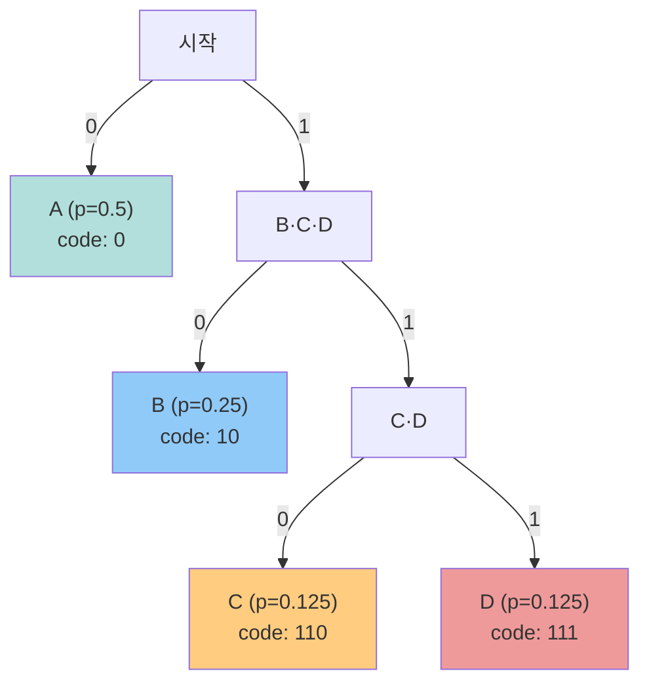
> 흔한 결과엔 짧은 코드(A=0), 드문 결과엔 긴 코드(D=111). 평균 길이 L̄ = 0.5×1 + 0.25×2 + 0.125×3 + 0.125×3 = **1.75 bits** (= H(X)).
- **중요 성질**: `0 ≤ H(X) ≤ log₂|X|`. ⭐ **균등분포에서 엔트로피 최대** (`P_X = U_m ⟹ H(X) = log₂ m`).
  - 예: `H(1,0)=0 < H(0.9,0.1)≈0.469 < H(0.5,0.5)=1`. 치우칠수록 평균 정보량 감소.

### 문자열 ≠ 분포 (중요 통찰)
- **복잡해 보여도 예측 가능**: `7f9a...`가 시간·카운터로 **결정적 생성**됐다면 공격자가 재현 가능.
- **단순해 보여도 정상**: 공정한 동전에서 우연히 `000000`이 나와도 생성 과정 자체가 결함은 아님.
- → **엔트로피는 '그 결과물'이 아니라 '생성 과정'을 평가해야 한다.**

### 난수 생성 파이프라인
```
Noise source(불확실성 수집) → Conditioning(편향 제거·entropy 집중)
→ DRBG(seed로 상태 초기화·갱신) → Output(키·nonce·salt에 목적별 사용)
```
> 출력이 그럴듯해 보이는지만 검사하면 source 고장·state compromise를 못 찾음.

### PRNG vs CSPRNG ⭐
| 구분 | PRNG | CSPRNG |
|------|------|--------|
| 목표 | 통계적 품질·**재현성** | **예측 저항**·상태 보호 |
| seed | 실험에서 고정 가능 | 충분한 entropy로 비밀 초기화 |
| 상태 노출 | 보안 요구 아님 | 과거·미래 출력 보호 중요 |
| 용도 | 시뮬레이션·게임 | **키·token·nonce 생성** |

> ⭐ **키·nonce는 반드시 CSPRNG로** 생성. 일반 PRNG는 seed가 같으면 출력이 재현되므로 암호용으로 금지.

### 💻 실습 코드 ⑤ PRNG 재현성 vs CSPRNG
```python
import random
from secrets import token_bytes
SEED = 2026; N = 16
r1 = random.Random(SEED); r2 = random.Random(SEED)
ord1 = bytes(r1.randrange(256) for _ in range(N))
ord2 = bytes(r2.randrange(256) for _ in range(N))
secure1 = token_bytes(N); secure2 = token_bytes(N)
print(ord1 == ord2)        # True : 같은 seed → 같은 PRNG 출력 (재현됨)
print(secure1 == secure2)  # 거의 항상 False : OS CSPRNG는 매번 새 난수
```
**이해 포인트**: 같은 seed의 PRNG(`random.Random`)는 **항상 같은 출력**(ord1==ord2 → True) = 예측 가능 = 암호용 부적합. `secrets.token_bytes`(OS CSPRNG)는 매번 다름(False). 핵심은 **entropy 값이 아니라 재현/예측 가능성 비교**.

### 키 수명주기 (Key Lifecycle) ⭐
```
Generate(CSPRNG·KDF) → Store(권한·HSM) → Use(용도·알고리즘 바인딩)
→ Rotate(기간·사용량·사고 기준) → Destroy(복구 정책과 함께 폐기)
```
- HSM = Hardware Security Module (하드웨어 보안 모듈).
- ⭐ **키 백업은 가용성을 높이지만 노출면도 늘림** → 복구 권한·조건을 함께 설계 (C vs A trade-off).

---

## 8. 체크포인트 (OX, 교수님 제공 — 그대로 외울 가치 있음)
1. ❌ "압축된 MP4의 byte entropy가 높으면 암호화된 파일임을 증명한다" → **거짓**. 압축·동영상도 높은 entropy. 엔트로피만으로 암호화 판정 불가.
2. ⭕ AES의 MixColumns는 한 byte 변화를 같은 열 여러 byte로 확산 → **참** (ShiftRows와 함께 여러 라운드에 걸쳐 state 전체 확산).
3. ⭕ CBC는 ECB 반복 패턴을 줄이지만 ciphertext 변조를 자동 검출 안 함 → **참** (encryption-only는 무결성 미제공).
4. ⭕ CTR에서 같은 key·nonce 재사용 시 두 ciphertext XOR로 두 plaintext의 XOR 노출 → **참**.
5. ⭕ AEAD의 AAD는 공개될 수 있지만 변경되면 tag 검증이 실패해야 함 → **참** (AAD는 암호화 안 되지만 ciphertext와 함께 인증).

---

## ✅ 2주차 결론
**원시 암호(primitive)보다 '실패를 막는 조합'이 실전 보안을 결정한다.**
세 가지 질문으로 점검:
- **예측 불가능한가?** → entropy · key (CSPRNG)
- **재사용되지 않는가?** → nonce · state (nonce 유일성)
- **변조를 거부하는가?** → AEAD · negative test (tag 검증)
