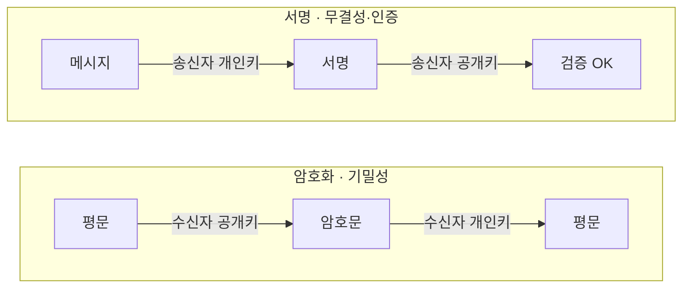
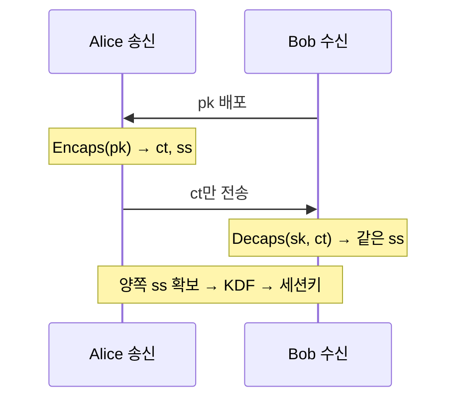
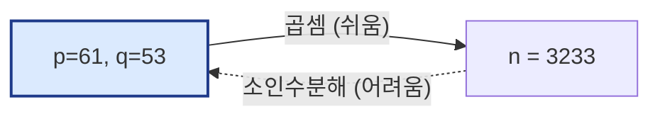
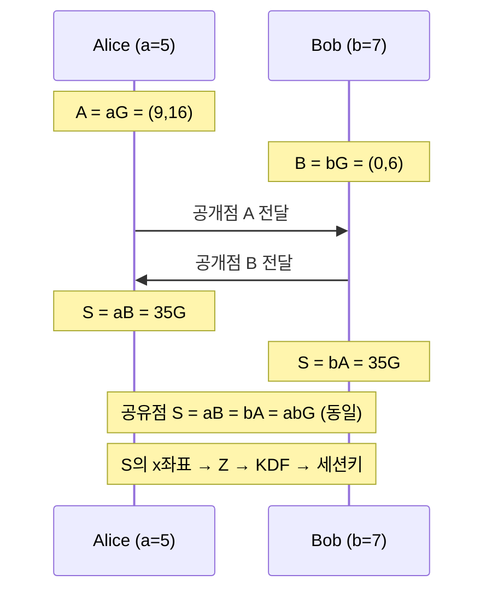

# 3주차 핵심 정리 ① — 공개키에서 신뢰까지 (Public-Key)

> 서사: 공개키 암호 → KEM → Diffie-Hellman → RSA → ECC → 인증서 → PQC
> 핵심 관점: **공개키 암호는 하나의 기능이 아니라 4가지 다른 연산**이다. "누가 계산할 수 있고(개인키), 누가 검증할 수 있는가(공개키)"로 역할을 구분.

---

## 1. 공개키 암호의 4가지 연산 ⭐⭐ (가장 중요한 분류)

| 연산 | 입력 → 출력 | 목표 | 대표 |
|------|-------------|------|------|
| **공개키 암호화** (Public-key encryption) | message → ciphertext | 기밀성 | RSA-OAEP |
| **키 합의** (Key agreement) | 양측 secret → shared secret | 공유키 설정 | DH, ECDH, X25519 |
| **KEM** (Key Encapsulation Mechanism) | public key → ciphertext + shared secret | 공유키 설정(단일 API) | 표준 KEM, ML-KEM |
| **전자서명** (Digital signature) | message + private key → signature | 무결성·인증 | RSA-PSS, Ed25519 |

### 공개키 ↔ 개인키 역할 (대칭키와 달리 "만능 쌍"이 아님)
- **Public key**: 배포해도 됨. 검증·암호화·encapsulation **입력**. 단, **누구의 키인지 인증 필요**(→ 인증서).
- **Private key**: 복호·decapsulation·서명에 쓰는 비밀. 노출 시 과거·미래 영향이 용도별로 다름.

### 암호화 vs 서명 — 반대 방향의 목표 ⭐

> ⭐ **암호화는 수신자 키, 서명은 송신자 키** — 사용 주체와 방향이 **반대**. (가장 헷갈리는 포인트)

---

## 2. 하이브리드 암호 & KEM ⭐

### 하이브리드 암호 (큰 데이터는 대칭키, 짧은 키는 공개키)
```
Session key(CSPRNG 생성) → AEAD로 데이터 보호
       ↑ Wrap/KEM으로 session key 전달 → Container(params·ciphertext·tag)
```
- ⭐ **공개키로 파일 전체를 직접 암호화하지 않는다.** 이유: ① 성능 ② 메시지 크기·안전한 encoding 제약.

### KEM (Key Encapsulation Mechanism)
- **정의**: 수신자의 public key로 **shared secret**과 전송용 **encapsulation ciphertext**를 만드는 공개키 메커니즘.
- **왜?**: 공개키 연산은 **짧은 key material만** 담당하고, 실제 데이터는 빠른 대칭키 AEAD로 보호. 하이브리드를 **일관된 인터페이스**로 구성.
- **왜 요즘 중요?**: NIST FIPS 203의 **ML-KEM**이 양자내성 표준으로 채택, HPKE(=KEM+KDF+AEAD) 구성, TLS·SSH 전환에서 고전 key agreement와 ML-KEM 결합.

**KEM 4값**:
| 표기 | 의미 | 비밀? |
|------|------|-------|
| **pk** | public key (누구에게나 배포) | 공개 |
| **sk** | secret key (수신자만 보관) | 비밀 |
| **ct** | encapsulation ciphertext (전송값) | 공개(전송) |
| **ss** | shared secret (양쪽이 동일 확보) → KDF로 세션키 | 비밀 |

**KEM 3알고리즘**: `KeyGen → (pk, sk)` / `Encaps(pk) → (ct, ss)` / `Decaps(sk, ct) → 같은 ss`

> ⭐ ct만 공개 채널로 전송. **shared secret 자체는 보내지 않고 수신자가 재현**. ss는 KDF를 거쳐 AEAD 세션키가 됨.

### KEM의 실제 프로토콜 적용 (관계)
- **기본 TLS 1.3 (RFC 8446)**: 일반 KEM이 아니라 **ECDHE/DHE** (양측이 기여하는 key agreement).
- TLS 1.3 PQC: **ECDHE + ML-KEM** 하이브리드(X25519MLKEM768 등).
- 핵심: 프로토콜은 KEM의 shared secret을 **그대로 데이터 키로 쓰지 않고**, transcript·기존 secret과 함께 **KDF**에 넣어 세션키 생성.

---

## 3. Diffie-Hellman (DH) ⭐

- **원리**: 비밀값 a, b를 **보내지 않고** 공개값을 교환해 **같은 shared secret 계산**. `gᵃ → gᵇ ←, shared = gᵃᵇ`.
- **X25519**: 이 원리를 **타원곡선 위에서** 쓰는 표준 함수.
- ⭐⭐ **Key agreement ≠ authentication**: DH는 shared secret은 만들지만 **상대의 신원(identity)은 증명하지 못함**.

### 중간자 공격 (MITM) ⭐

- 인증되지 않은 DH에서 Mallory가 Alice·Bob 사이에서 **두 개의 안전한 채널을 따로** 만듦 (K₁: Alice↔Mallory, K₂: Mallory↔Bob).
- Alice는 Mallory를 Bob으로, Bob은 Mallory를 Alice로 믿음.
- **방어**: 인증서·PSK·전자서명으로 **교환값을 인증**해야 함.

---

## 4. RSA ⭐⭐ (실습 수식 포함)

### 기반 난제: 일방향 비대칭성

> `n = p × q`는 쉽게 계산하지만, **n에서 p, q를 찾는 소인수분해는 어렵다**. 2048-bit n은 고전 컴퓨터로 사실상 불가.
- `n = p × q`는 쉽게 계산하지만, **n에서 p, q를 찾는 소인수분해는 어렵다**.
- 예: p=61, q=53 → n=3233 (즉시). 역방향(3233→61,53)은 toy에선 쉽지만 **2048-bit n은 고전 컴퓨터로 어려움**.
- **왜 어려운가**: 단순 전수조사(trial division)는 √n까지 시험(2048-bit의 √는 ~1024-bit). 최선의 알려진 방법 **GNFS**도 빠르지만 **다항시간(polynomial-time)은 아님**. → modulus 비트 길이로 보안 강도 조절.

### 수론 용어 (RSA 전제)
| 용어 | 정의 | 예 |
|------|------|-----|
| 소수(prime) | 1과 자신만 약수 | 53, 61 |
| 인수(factor) | 곱해서 수를 만듦 | 3233 = 53×61 |
| 최대공약수(GCD) | 공유하는 가장 큰 약수 | gcd(12,18)=6 |
| 서로소(relatively prime) | GCD가 1 | gcd(17,3120)=1 |

### 모듈러 연산 (큰 거듭제곱 처리)
- `29 mod 12 = 5` (29=2×12+5). `29 ≡ 17 ≡ 5 (mod 12)` (합동).
- `(a·b) mod n = [(a mod n)(b mod n)] mod n` → **aᵉ 전체를 만들지 않고 제곱하며 mod n으로 줄임** (repeated squaring, O(log e)).
- 예: `14⁵ mod 10` = 4. (14≡4, 14²≡6, 14⁴≡6, 14⁵=6×4≡4). Python: `pow(14,5,10)`.

### 핵심 수론 정리 (📝 필기: "기묘한 알고리즘 — 페르마 정리·오일러 정리 활용해 알아두기")
- **오일러 파이 함수** φ(n): n보다 작고 n과 서로소인 양의 정수 개수. φ(10)=4(1,3,7,9).
- ⭐ **φ(pq) = (p-1)(q-1)** (p,q 서로 다른 소수). 예: φ(15)=2×4=8.
- **페르마 소정리**: p 소수, gcd(a,p)=1 → `a^(p-1) ≡ 1 (mod p)`.
- **오일러 정리**: gcd(a,n)=1 → `a^(φ(n)) ≡ 1 (mod n)`. ← **RSA 복호가 되는 핵심 근거**.
- **모듈러 곱셈 역원**: `e·d ≡ 1 (mod φ(n))` → d = e⁻¹ mod φ(n) (확장 유클리드로 계산). e와 φ(n)이 서로소일 때 d 존재.

### RSA 키 생성 ⭐
| 단계 | 계산 | 의미 |
|------|------|------|
| 1 | 큰 소수 p, q 선택 | **p,q는 끝까지 비밀** |
| 2 | n = pq | 공개 modulus |
| 3 | φ(n) = (p-1)(q-1) | 오일러 정리용 |
| 4 | gcd(e, φ(n))=1인 e | 공개 지수 |
| 5 | d = e⁻¹ mod φ(n) | 개인 지수 |
| 6 | public=(n,e), private=(n,d,p,q,...) | 공개/비밀 분리 |

**Toy 예시** (끝까지 계산): p=61, q=53 → n=3233, φ=60×52=3120, e=17(gcd(17,3120)=1), d=2753 (17×2753=46801=15×3120+1). → public=(3233,17), private=(3233,2753).

### RSA 암호화·복호화·서명
- **암호화**: `C = Mᵉ mod n`. 예: M=65, (3233,17) → C=65¹⁷ mod 3233 = **2790**.
  - repeated squaring: 65²≡992, 65⁴≡1232, 65⁸≡1547, 65¹⁶≡789, 65¹⁷=789×65≡2790.
- **복호화**: `M = Cᵈ mod n`. 2790²⁷⁵³ mod 3233 = **65**.
- **왜 복원되나**: `M^(ed) = M^(1+kφ(n)) = M·(M^φ(n))^k ≡ M·1^k ≡ M (mod n)` (오일러 정리). M이 n과 서로소 아니어도 **CRT(중국인 나머지 정리)**로 완성.
- **서명** (📝 필기 정확): `C = (H(m))^d mod n` (개인키 d로 서명) → 검증 `C^e mod n = (H(m))^(ed) ≡ H(m)` (공개키 e로). 즉 **메시지 해시 H(m)에 서명**.

> 📝 **필기 교정/보강** (p.30 손필기): "Alice의 공개키가 정말 Alice의 공개키인지 어떻게 검증? → 인증서 발급, **CA**." 정확함. RSA 서명의 전제는 공개키가 진짜 그 사람 것인지 보증하는 PKI/CA.

### 왜 인수분해가 RSA를 깨는가 ⭐

→ **p,q 보호 + 충분한 modulus 크기**가 핵심. padding·구현 안전성도 별도 필요.

### Raw RSA가 아니라 "스킴"을 써야 한다 ⭐
| 목적 | 현대 스킴 | 피할 것 |
|------|-----------|---------|
| 암호화 | **RSAES-OAEP** | `Mᵉ mod n` 직접, PKCS#1 v1.5 신규 |
| 서명 | **RSASSA-PSS** | '개인키로 암호화'식 자체 서명 |
| 대용량 | 하이브리드 암호 | RSA로 파일 전체 암호화 |
| 구현 | 검증된 라이브러리·HSM | 직접 prime·padding·CRT 구현 |

---

## 5. ECC (타원곡선 암호) ⭐

- **RSA = 인수분해**, **ECC = 타원곡선 이산로그 문제(ECDLP)**.
- **정방향**: private scalar k와 기준점 G로 `Q = kG` 계산 (쉬움).
- **역방향**: G와 Q만 보고 k 찾기 = **ECDLP** (어려움).

### ⭐ 같은 보안 강도에 ECC가 훨씬 짧은 키 (장점)
| 보안 강도 | RSA modulus | ECC field/order |
|-----------|-------------|-----------------|
| 112-bit | 2,048 | 224~255 |
| 128-bit | 3,072 | 256~383 |
| 256-bit | 15,360 | 512+ |
> ECC는 짧은 키로 같은 보안 → 성능·대역폭 유리. (단, 수치는 공개키 파일 길이가 아니라 field/subgroup 크기 범위)

### 점 덧셈 (group law)
- 두 점 P, Q를 잇는 직선이 곡선과 만나는 세 번째 점을 x축 대칭 → P+Q. 실제 암호는 **유한체 𝔽ₚ에서 나머지 연산**.
- 서로 다른 점: `λ=(y₂-y₁)(x₂-x₁)⁻¹ mod p`, 같은 점(doubling): 접선 기울기.
- **scalar multiplication** = kG = 점 덧셈 반복.
- ⚠️ `(x₂-x₁)⁻¹`은 실수 나눗셈이 아니라 **modulo p의 곱셈 역원**.

### ECDH / ECDHE (타원곡선 DH)

- toy ECDH: Alice a=5→A=aG, Bob b=7→B=bG, 공유점 `S = aB = bA = abG`. S의 x좌표를 바이트열 Z로 → KDF로 세션키.
- **ECDHE**의 마지막 **E = Ephemeral(임시)**: 매 핸드셰이크마다 a·b를 새로 생성하고 사용 후 폐기 → **Forward Secrecy**. 상대 인증은 인증서·서명이 별도 담당(장기 서명키 ≠ 임시 a·b).

### 현대 ECC 함수 (목적별로 다른 표준) ⭐
| 알고리즘 | 목적 | 주의 |
|----------|------|------|
| **X25519** | 키 합의(ECDH) | TLS 1.3·SSH 임시키, 공개값·Z 각 32바이트 |
| **ECDSA** | 전자서명 | P-256 인증서. **nonce 재사용·편향 시 개인키 노출** ⚠️ |
| **EdDSA/Ed25519** | 전자서명 | SSH 등. X25519와 목적·인코딩 다름 |
| **secp256k1** | ECDSA/Schnorr | Bitcoin. P-256·Curve25519와 다른 곡선 |
> ⭐ 구현 사고는 알고리즘보다 **nonce·encoding·key 보호** 같은 사용 조건에서 발생.

---

## 6. 전자서명과 신뢰 (업데이트 사례)

### 서명은 digest에 적용
- `signable bytes → h = Hash(signable bytes) → signature = Sign(private key, h)`.
- **context**(domain separator): 문서 종류·protocol·version·filename·role 등 bytes의 **의미를 고정**. 중요하면 서명 입력에 포함.

### ⭐ "파일 해시만 서명"의 함정 (재전송 공격)
- 파일 hash만 서명하면 → 과거 정상 파일(구버전)을 **'최신판'처럼 재전송**해도 서명이 유효. "어느 제품의 최신 허용 버전인가"를 판단 못 함.
- **해결**: 배포 목록(**manifest**: product·version·platform·file·hash·expires)을 **직렬화해 통째로 서명**. 검증자가 version·expires 정책까지 확인.
- **TUF(The Update Framework)**: 역할별 metadata 서명으로 **rollback(구버전 되돌리기)·freeze(옛 metadata 계속 보여주기)** 공격까지 방어. Signature 검증 + version/expiry/state 검증을 함께.

### 서명 알고리즘 요약
| 계열 | 현대 사용 | 구현 주의 |
|------|-----------|-----------|
| RSA | RSASSA-PSS | 충분한 key size·안전한 padding |
| ECDSA | P-256 | **nonce 재사용/편향 시 개인키 노출** |
| EdDSA | Ed25519 | 정형화된 API, context·key 보호 |
| PQC | 격자/해시 기반 서명 | 새 크기·성능·성숙도 평가 |

---

## ✅ 핵심 비교: Hash vs HMAC vs Signature (누가 계산/검증?)
| | 생성 | 검증 | 제3자 검증 |
|---|------|------|-----------|
| **Hash** | 누구나 | 누구나 | 출처 증명 못 함 |
| **HMAC** | 공유키 보유자 | 공유키 보유자 | 공유자끼리 생성자 구분 못 함 |
| **Signature** | 개인키 보유자 | 공개키 보유자 모두 | 가능(단, key identity 연결 필요) |
> 📝 필기(정확): 전자서명은 **느리다**(공개키 연산). 그래서 `m → H(m) → Sign(H(m))`처럼 해시에 서명.
