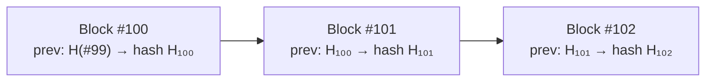
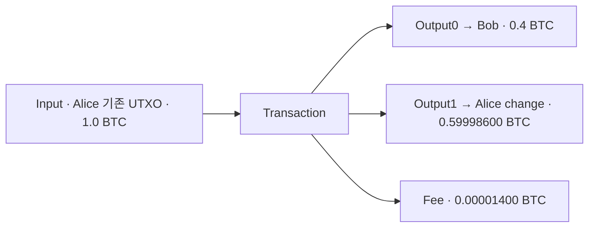
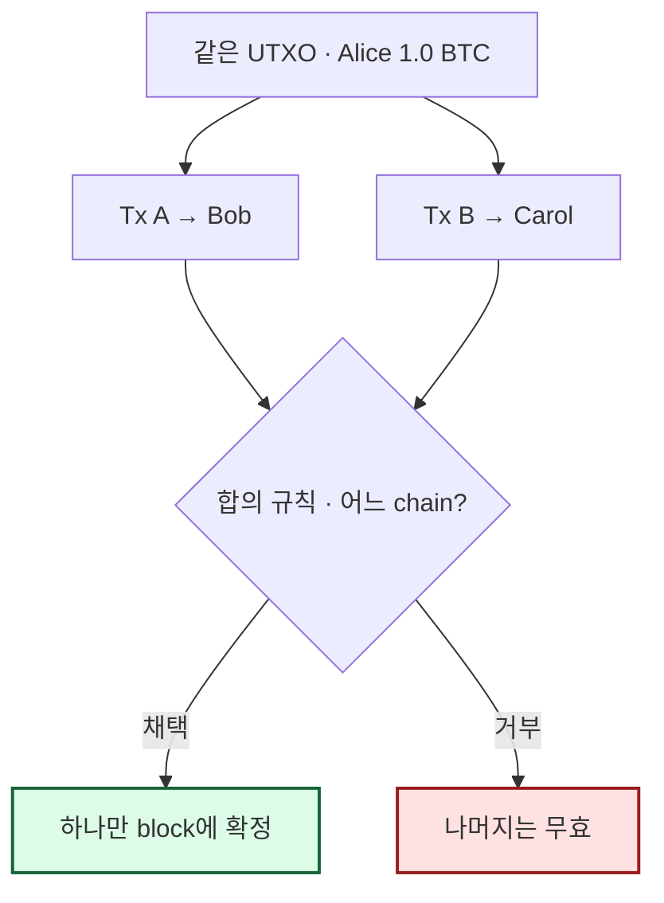
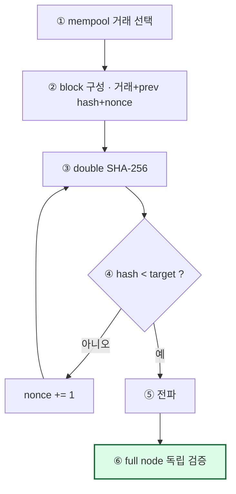
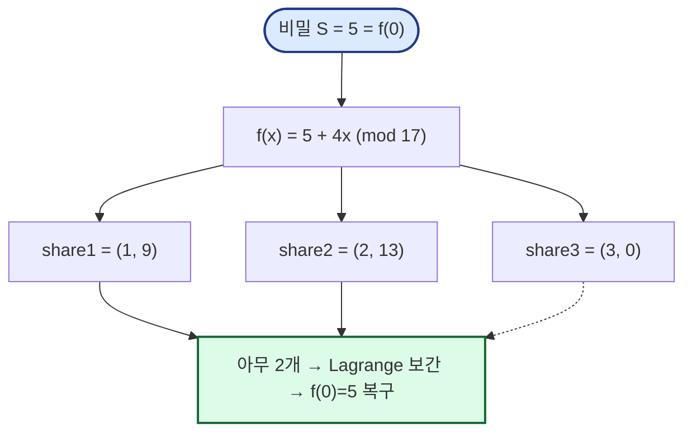

# 4주차 핵심 정리 — 응용 암호: 블록체인과 Shamir 비밀분산

> ⚠️ 두 파트는 **직접 연결되는 기술이 아니라** 암호 primitive의 서로 다른 응용 사례. (해시·전자서명을 각각 다르게 활용)

---

# PART 1. 블록체인과 비트코인

## 1. 중앙 장부 → 분산 장부 (왜 블록체인인가)
- **중앙 장부(은행)**: 한 기관이 장부의 정답을 관리(거래 순서·잔액·취소 최종 결정). 모든 참여자가 **한 장부를 신뢰**하는 전제.
- **분산 장부**: 중앙 관리자 제거 → **모든 node가 검증 규칙·합의 규칙에 따라 하나의 기록 순서를 선택**해야 함.
  - 문제: Alice가 거의 동시에 두 거래 전파 시 Node1은 A를, Node2는 B를 먼저 봄 → 순서 합의 필요.

## 2. 블록체인 핵심 구조 ⭐
- **블록체인 = 거래 묶음을 이전 block의 hash로 연결한 복제 장부.**
- **Block**: 일정 기간 거래 + 검증 정보 묶음. **Previous block hash**: 앞 block 내용을 가리키는 암호학적 요약값.
- ⭐ **한 거래를 바꾸면 그 block의 hash와 뒤의 모든 연결이 달라진다** → 변조 탐지 (해시 체인의 무결성).

> 각 block이 **앞 block의 hash**를 품으므로, 과거 거래 하나만 바꿔도 이후 모든 hash가 어긋나 변조가 드러난다.

### Blockchain ≠ Bitcoin ≠ Mining ⭐ (포함관계 아니라 역할이 다름)
| 용어 | 역할 |
|------|------|
| **Blockchain** | 여러 node가 복제한 기록을 block+hash link로 관리하는 **구조** |
| **Bitcoin** | blockchain 위에서 공급량·소유권·지급 규칙을 정의한 **전자화폐 시스템** |
| **Mining** | Bitcoin에서 새 block 후보를 만들고 **PoW를 찾는 과정** |
> ⭐ **모든 blockchain이 mining을 쓰는 것은 아니다** (합의 방식은 다양).

## 3. Bitcoin 발행 정책
- **발행 상한 ≈ 2,100만 BTC** (누구도 임의 추가 발행 불가).
- **Halving**: 210,000 block마다 block subsidy 절반 (50→25→12.5→6.25→3.125 BTC, 2024~).
- 약 2140년 subsidy=0 → 신규 발행 종료, miner 수익은 **transaction fee 중심**으로 전환.
- 설계 의도: 중앙 주체 없이 예측 가능한 발행·희소성, subsidy→fee로 보안 보상 점진 전환. (📝 필기: "왜 하필 2,100만?"에 대한 확정 설명은 없음)

## 4. 참여자: Wallet / Full node / Miner ⭐ (역할 구분)
| 참여자 | 역할 |
|--------|------|
| **Wallet** | private key 관리, UTXO 선택, output·fee 구성, transaction 서명·전송 |
| **Full node** | **Bitcoin 합의 규칙을 독립 검증**. transaction·block 전체 검증·relay, 유효 chain 유지 |
| **Miner** | 유효 거래 선택, candidate block 생성, **PoW 탐색**, 성공 block 전파 |
> ⭐ **Miner가 block을 제안해도 full node의 규칙 검증을 통과해야 한다** (miner가 멋대로 못 함).

## 5. 소유권: 개인키·주소 ⭐
- **Private key**: 소비 승인(서명). **Public key**: private key에서 수학적으로 유도. **Address/script**: 잠금 조건 표현.
- ⭐ **주소는 공개키 그 자체가 아니라** '어떤 조건으로 이 output을 소비할지'를 식별하는 표현.
- 실제 서명: ECDSA, Taproot의 Schnorr signature.

## 6. UTXO 모델 ⭐⭐
- **UTXO (Unspent Transaction Output)**: 아직 소비되지 않은 거래 출력. '누가 얼마를 쓸 수 있는지' 기록한 금액 단위. 다음 거래의 input으로 쓰기 전까지 UTXO.
- **지갑 잔액 = 보유 UTXO의 합계.** 기존 UTXO 전체를 소비하고 **지급액 + 거스름돈(change) UTXO를 새로 생성**.
  - 예: 1.0 BTC input → Output0(Bob 0.4) + Output1(change: Alice 0.59998600) + fee.

> 기존 UTXO를 **통째로 소비**하고 지급액·거스름돈을 **새 UTXO로 생성**. 입력 합 − 출력 합 = fee.

## 7. Transaction Fee ⭐
- **Fee = Σ input values − Σ output values** (거래 생성자가 제안).
- satoshi(sat): 최소 단위, 1 BTC = 100,000,000 sat.
- 중앙 수수료 관리자 없음: Wallet이 fee rate 제안 → Miner가 coinbase transaction으로 보상 청구 → Full node가 상한 초과 시 거부.
- **현재(2026) block reward = block subsidy 3.125 BTC + 포함 거래 fee 합계.**
- **Fee rate = 총 fee ÷ virtual size [sat/vB]**. 같은 block 공간에서 **높은 fee rate 거래가 먼저 확정**. (vB = virtual byte, SegWit witness 할인 반영)
  - 예: 140vB·1400sat(=10 sat/vB) 2개 = 2800sat vs 280vB·1400sat(=5 sat/vB) 1개 → **같은 280vB에서 A조합이 수익 큼**.

## 8. 전자서명 (Bitcoin에서) ⭐
- 서명은 거래를 **암호화하지 않고** UTXO의 **소비 권한을 증명**.
- ⭐⭐ **핵심 오해 교정**: Bitcoin 거래는 **공개된다**. 서명은 **기밀성(encryption)이 아니라 승인·무결성**을 제공.

## 9. Transaction Relay & Mempool
- 유효 거래 검증 항목: ① 참조 UTXO 존재 ② 이중지불 아님 ③ 서명·script 유효 ④ 금액·형식 규칙.
- 검증 통과 → **mempool**(각 node가 아직 block에 안 들어간 유효 거래를 임시 보관하는 로컬 집합).

## 10. 이중지불 (Double Spending) ⭐
- **정의**: 동일 UTXO를 서로 다른 두 transaction의 input으로 사용하는 시도.
- Alice가 A(→Bob), B(→Carol)를 둘 다 서명해 전파 → Node들이 다른 걸 먼저 봄.
- ⭐ **전자서명은 두 거래를 Alice가 승인했다는 사실만 증명.** 어느 것을 기록할지는 **block과 합의 규칙이 결정**. 같은 chain에서 A·B는 동시에 유효 불가. 후속 block이 쌓일수록 **confirmation 증가**.

> 서명은 "둘 다 Alice가 승인했다"만 증명. **동시 유효는 불가** — block·합의 규칙이 하나만 확정.

## 11. Mining · Proof of Work (PoW) ⭐⭐
- **채굴 = 복호가 아니라 target 이하의 header hash를 찾는 반복 탐색.**
- 과정: ① mempool에서 거래 선택 ② block 구성(거래+previous hash) ③ **nonce를 바꾸며 double SHA-256** ④ **target(hash 상한) 이하면** 전파 ⑤ node가 규칙·PoW·거래 독립 검증.

> 평균 시도 ≈ 2ᵈ. 성공한 block도 **node 검증을 통과해야** 체인에 반영.
- ⭐ **어떤 chain을 따르는가**: 유효한 chain 중 **누적 PoW가 가장 큰 chain**.
- **Confirmation**: 거래 포함 block 위에 후속 block이 쌓인 정도. 많을수록 재구성 위험↓.
- Miner 보상: coinbase transaction으로 subsidy + fee 청구.

### 💻 실습 코드: PoW 채굴 (nonce 탐색)
```python
import hashlib, time
difficulty_bits = 20          # 16, 20, 24로 변경
target = 1 << (256 - difficulty_bits)   # hash 상한
previous_hash = "00" * 32
transactions = "Alice->Bob:0.1 BTC"
nonce = 0
while True:
    header = (previous_hash + transactions + str(nonce)).encode()
    first = hashlib.sha256(header).digest()
    hash_hex = hashlib.sha256(first).hexdigest()   # double SHA-256
    if int(hash_hex, 16) < target:                 # target 미만이면 성공
        break
    nonce += 1
```
**이해 포인트** ⭐:
- 성공 조건: `int(hash,16) < 2^(256-d)`. 한 번 성공 확률 ≈ **2⁻ᵈ**, 평균 시도 ≈ **2ᵈ**.
- **difficulty_bits가 4 증가 → 평균 시도 16배(2⁴)**. d=16: 65,536 / d=20: 1,048,576(16×) / d=24: 16,777,216(256×).
- `target`은 큰 수일수록 쉬움(d가 작을수록 target 큼). double SHA-256 사용.
- 평균은 2ᵈ이지만 한 번의 결과는 크게 변동(확률적).

---

# PART 2. Shamir 비밀분산 (독립 주제)

> Blockchain과 직접 의존 관계 없음. 하나의 비밀을 여러 share로 나눠 공동 복구하는 응용.

## 1. Shamir's Secret Sharing (SSS) ⭐
- **정의**: 비밀 S를 n개 share로 나누고, 그중 **임의의 k개로 복구**하는 **(k,n) threshold scheme**.
- **왜?**: 비밀키 하나의 분실·탈취라는 **single point of failure 완화**.
- 예: (2,3) — 교수/조교/학과장 share 3개 중 **아무 2개**면 복구. 어느 조합(1+2, 1+3, 2+3)이든 가능.
- ⭐ **한 share만으로는 비밀에 대한 정보를 전혀 얻지 못한다** (perfect secrecy).

## 2. Share 생성 — 비밀은 다항식의 y절편 ⭐⭐
- 비밀 S를 **다항식의 상수항(y절편)**으로, share는 **서로 다른 점**으로.
- (2,3), prime p=17 예: 비밀 S=5, 무작위 계수 a=4 → **f(x) = 5 + 4x (mod 17)**, `secret = f(0)`.
  - share1 = (1, 9), share2 = (2, 13), share3 = (3, 0).
- 실제 구현은 충분히 큰 **finite field**와 **암호학적으로 안전한 난수** 사용.

## 3. 복구 (Lagrange interpolation) & Perfect Secrecy ⭐⭐
- **복구**: 2개 share → 유일한 degree-1 다항식 → y절편(비밀) 복구.
  - P₁=(1,9), P₂=(2,13): `a=(13-9)×(2-1)⁻¹=4 (mod 17)` → f(x)=5+4x → **S=f(0)=5**.
- ⭐ **한 점만으로는 비밀 결정 불가** (perfect secrecy의 핵심):
  - P₁=(1,9)만 알 때: S=5,a=4 / S=8,a=1 / S=12,a=14 ... 모두 `?+?≡9`를 만족 → **가능한 secret이 하나로 안 좁혀짐**.
- ⭐ **일반 (k,n)**: **degree k-1 다항식** 사용. **k-1개 이하 share는 secret 정보를 주지 않음**. (k개 모여야 복구)
> 직관: 2점이면 직선(1차) 유일 결정, 1점이면 무한한 직선 가능. k점이면 (k-1)차 다항식 유일 결정.

> (2,3): 비밀=1차 다항식 상수항. **2점이면 직선 유일 → 복구**, 1점만으론 가능한 직선이 무한 → **정보 0(perfect secrecy)**.

## 4. 활용과 한계
- **활용**: 암호키·복구키 조직별 분산 보관, 재해복구 2-of-3 승인, 서로 다른 장소 offline backup, 단일 보관자 위험 완화.
- **운영 주의**: 각 share도 **기밀·무결하게** 보관, 잘못된 share 제출 **별도 검출**, threshold 미만 영구 분실 방지 백업, 큰 finite field·안전 난수.
- ⭐ **Shamir(share 합쳐 원래 private key 복구) ≠ multisignature(여러 독립 key가 각각 서명)** — 다른 메커니즘.

## 5. 가중치 Shamir (Weighted SSS) ⭐
- 가중치 큰 참여자에게 **서로 다른 share를 더 배정**.
- 예: threshold=3. 학과장 share 2개(서로 다른 x좌표), 교수들 각 1개.
  - 복구 가능: 학과장+교수1(2+1=3), 교수 3명(1+1+1=3)
  - 복구 불가: 학과장만(2), 교수 2명(1+1=2)
- ⭐ **같은 share를 복제하면 정보가 늘지 않는다** → 학과장에게 **서로 다른 x좌표**의 share 2개를 줘야 함.
- (3,5) 수치 예: f(x)=5+4x+2x² (mod 17), threshold 3이라 **2차 다항식**(상수항 f(0)=5가 비밀). 3개 share 모이면 Lagrange 보간으로 f(0)=5 복구.
- 일반화: weight wᵢ 참여자에게 서로 다른 share wᵢ개 배정, 총 k개 모이면 복구.

---

## ✅ 4주차 핵심
- **블록체인**: 해시 체인으로 무결성, PoW로 합의, UTXO·전자서명으로 소유권/지급. (서명=기밀성 아님, 승인·무결성)
- **Shamir**: (k,n) threshold, 비밀=다항식 상수항, k-1개 이하 share는 정보 0 (perfect secrecy), Lagrange 보간으로 복구.
- **공통**: 둘 다 **암호 primitive(해시·서명·다항식)의 응용**이지 서로 연결된 기술이 아님.
